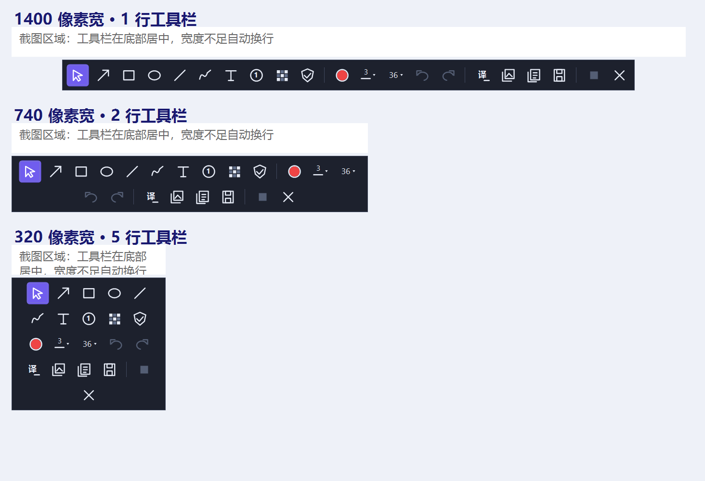

# 快译截图 · QuickZh Screenshot

在 Windows 上框选文字，本地 OCR 识别后交给大模型翻译，让中文直接显示在截图的原文字位置，并支持截图标注、复制和保存。

**当前版本：v1.0.0 预览版。** 适用于 Windows 10 / 11 x64，使用 .NET Framework 4.8；尚未完成多台电脑和不同 DPI / 多显示器组合的实机验收。

[下载程序](https://github.com/ceonoones/quickzh-screenshot/releases/tag/v1.0.0) · [使用说明](docs/使用说明.md) · [更新日志](CHANGELOG.md) · [反馈问题](https://github.com/ceonoones/quickzh-screenshot/issues)



图片由本程序实际离屏绘制；白色区域为截图区域示意，不是第三方客户端截图。

## 开始使用

1. 下载 `QuickZhScreenshot-1.0.0-win-x64.exe`，放在固定文件夹，双击运行。免安装，OCR 执行器与模型随 EXE 内置，不需要 Python。
2. 打开设置，填写自己的 OpenAI 兼容 API 地址、Key 和模型，按需要修改中文翻译提示词。支持 DeepSeek 及兼容服务；API 服务和费用由用户自行选择。
3. 默认按 **Ctrl+Alt+Q**，拖动选择屏幕上的文字；松开后自动识别并原位翻译。
4. 用工具栏切换原文 / 译文、添加箭头或文字、连续画圈画框、数字标注或马赛克。复制截图或保存桌面成功后自动关闭浮窗。

EXE 约 126 MiB。首次识别会将内置资源展开到本机应用数据目录，之后复用。普通使用不需要下载开发用的 `engine.zip`。程序未提供代码签名。

## 功能

- OCR 在本地 CPU 上执行，使用 RapidOCR / ONNX，保留 Tesseract 后备；英文、俄文等模型内置。
- 只将识别出的文字和提示词发送至用户配置的 API，截图不上传至翻译服务。
- 按原文区域放回译文，估算字号、颜色和段落；尽量保留文字以外的图标和背景，支持手动“保留原图”。
- 字号默认 36 px，文字可拖动、双击编辑及四角缩放；方框和圆圈持续绘制，切换移动工具后调整位置和大小。
- 箭头、线条、画笔、连续数字、马赛克、撤销和重做；按截图宽度自动换行的大图标工具栏。
- 复制原文、译文、截图，保存 PNG 到桌面；可配置截图热键、开机启动和系统托盘。
- 托盘待机不轮询截图或网络，不常驻 OCR 子进程。

## 隐私、恢复与限制

API Key 按设计以明文保存在 `%LOCALAPPDATA%\快译截图\设置.json`，不会随程序或源码发布。不要公开自己的配置文件、Key、屏幕隐私或未经脱敏的错误内容。翻译服务能接收原文，请自行选择可信端点。

退出托盘后删除 EXE 即可移除程序。完整清理时先取消“开机启动”，再删除 `%LOCALAPPDATA%\快译截图` 下的设置和展开资源；如需恢复设置，请先自行备份。

OCR 对艺术字、模糊图片和图文字形混淆仍可能识错。原图是位图，无法恢复网页字体文件；译文过长时仍可能缩小。需要查看准确原文时切换原图。不同 DPI、多屏、字体及 CPU 配置可能影响排版和性能。

## 从源码构建

需要 Windows x64、系统 .NET Framework 编译器和 PowerShell。无需 Visual Studio。第一次构建下载固定校验值的 OCR 资源：

```powershell
.\tools\prepare.ps1
.\src\build.ps1
.\src\build.ps1 -Tests
& .\src\验证.exe
```

`prepare.ps1` 只下载公开资源，核对 SHA-256 后放入 `src/engine.zip`。离线时从资源 Release 下载同一文件并放在该位置。完整源码附件已经包含资源，可直接构建；GitHub 自动生成的源码压缩包则需要先执行准备脚本。

目前自动检查覆盖 **204 项**：本地英俄 OCR、流式 API 与错误处理、坐标与像素保留、连续绘图、移动缩放、数字和马赛克、剪贴板与保存、工具栏换行。默认检查只调用本机 HTTP 模拟服务，不需要真实 API Key。完整桌面鼠标流程、跨电脑实机使用及所有语言均未完成验证。提供的 `--live-*` 验证入口会请求用户配置的真实 API，可能产生费用，CI 不执行这些入口。

[构建说明](docs/开发说明.md) · [验证范围](docs/验证范围.md) · [第三方许可](THIRD_PARTY_NOTICES.md) · [贡献指南](CONTRIBUTING.md) · [安全政策](SECURITY.md)

## 许可与关系

本项目原创 C# 代码及原创文档按 [MIT](LICENSE) 开源。OCR 执行器、模型、运行库和测试样本各自保留上游许可，不因本项目 MIT 许可而变更。详见第三方声明与资源包中的 `licenses/`。

工具栏的交互形式参考 [Flameshot](https://github.com/flameshot-org/flameshot)，图标使用 GDI+ 自行绘制，没有复制其代码或图标。本项目与 Flameshot、DeepSeek、OCR 上游或 API 服务商均无官方关联。
